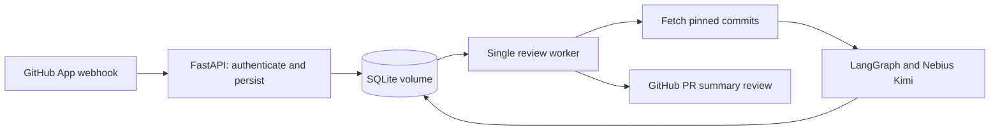

# GitHub PR comments: first hosted version

This version posts one **summary PR review** per revision, using GitHub's `COMMENT` event. It does not post inline comments, approve/request changes, create Checks, suggest patches, create branches, or push commits. It uses the same three-specialist LangGraph workflow as the CLI.



## Containers

`compose.yaml` runs two instances of the same image:

- API: verifies webhook signatures, durably enqueues jobs, and provides health/job status.
- Worker: claims jobs, authenticates as a GitHub App, fetches code, runs reviewers, persists the report, and publishes the summary.

A named volume holds the SQLite database. This is a **single-host, single-worker learning deployment**; do not horizontally scale the worker or place the database on a network filesystem. Keep both containers on the same host. PostgreSQL and a distributed queue can replace this module later. Restarting containers preserves queued work; `docker compose down -v` deletes it.

The webhook handler performs no GitHub or model requests. GitHub source is sent to the configured Nebius model by the worker. Install the App only on repositories approved for that processing.

## GitHub App configuration

Register a GitHub App with:

- Webhook URL: `https://YOUR_PUBLIC_HOST/webhooks/github`.
- Webhook secret: a random string of at least 32 characters.
- Repository permissions: **Contents: Read-only** and **Pull requests: Read and write**. Metadata read access is implicit. No Contents write, Actions, or Checks permissions are needed.
- Event subscription: **Pull request**.

Generate an App private key and install the App on selected repositories. The service handles `opened`, `synchronize`, `reopened`, and `ready_for_review`; draft and closed PRs are ignored. Publication itself does not trigger another supported event.

GitHub App setup and installation happen in your account; no App, webhook, deployment, or actual PR comment was created as part of implementing this code.

## Environment

Keep the existing Nebius key in `.env`. Add the following values without overwriting that key:

```dotenv
GITHUB_APP_ID=YOUR_NUMERIC_APP_ID
GITHUB_PRIVATE_KEY_FILE=/absolute/host/path/to/github-app.pem
GITHUB_WEBHOOK_SECRET=YOUR_RANDOM_WEBHOOK_SECRET_AT_LEAST_32_CHARACTERS
REVIEW_API_TOKEN=A_DIFFERENT_RANDOM_TOKEN_FOR_JOB_STATUS
```

Use independent random secrets, for example by running `openssl rand -hex 32` twice. Put the webhook secret in both the App settings and `.env`. The status token is only for your own authenticated status requests; it is not a GitHub token.

`.env.example` documents the settings. `.env`, PEM files, key files, and the local database are ignored by Git. The Docker build context uses an allowlist and excludes credentials, reports, and temporary assets. Containers run as UID/GID 10001, with read-only root filesystems and separate writable data/tmp locations. Ensure the mounted App key is readable by UID 10001. Local Docker Compose file-backed secrets retain host-file permissions; secret UID/mode settings may not remap them. Use suitable host ownership/ACLs or a deployment secret manager rather than making private keys public.

## Start the API before GitHub App setup

If the App ID and private key are not ready, start the API alone after setting `GITHUB_WEBHOOK_SECRET` and `REVIEW_API_TOKEN` in `.env`:

```sh
docker compose -f compose.api.yaml up --build -d api
curl --fail http://localhost:8000/healthz
```

Opening `http://localhost:8000/` also returns API information. This mode can receive signed webhook deliveries and queue work, but it does not run reviews or post comments until the worker starts. Use the webhook secret already in `.env` when registering the App.

After setting `GITHUB_APP_ID` and `GITHUB_PRIVATE_KEY_FILE`, switch to the complete stack with the standard command below. The API service and database volume are shared, preserving queued work. Do not launch both Compose stacks as separate projects on the same port.

## Start the complete stack

Requires Docker with Compose:

```sh
docker compose up --build -d
docker compose logs -f api worker
```

The API binds to host loopback at port 8000. Expose it through an HTTPS reverse proxy or a development tunnel. GitHub cannot deliver to your laptop's localhost URL. Keep `/jobs` access protected by its bearer token; logs and responses do not return credentials or raw provider exceptions.

```sh
curl --fail http://localhost:8000/healthz
```

Endpoints:

| Method | Path | Authentication | Behavior |
| --- | --- | --- | --- |
| GET | `/` | None | API identification and endpoint paths |
| GET | `/healthz` | None | Process/database liveness; not GitHub/model readiness |
| POST | `/webhooks/github` | `X-Hub-Signature-256` | Validate raw-body HMAC, persist supported event, return 202 |
| GET | `/jobs/{job_id}` | `Authorization: Bearer REVIEW_API_TOKEN` | Execution status, attempt count, error type, published review ID |

The webhook response contains the job ID. It returns `duplicate` when a delivery/revision was already queued. Unsupported events/actions return `ignored`.

For local development without Docker:

```sh
uv pip install --python .venv/bin/python -e '.[server,dev]'
.venv/bin/uvicorn review_agent.server:create_app --factory --host 127.0.0.1 --port 8000 --no-access-log
# In a second terminal, from the same project directory:
.venv/bin/review-worker
```

Both processes default to `data/reviews.sqlite3`. For another working directory, set the same absolute `REVIEW_DB_PATH` in both environments. The editable project's `.env` is loaded automatically; shell variables take precedence.

## Execution and recovery

1. The handler verifies the HMAC over raw bytes and validates installation/repository/PR identifiers. It limits webhook bodies to 1 MB.
2. The queue deduplicates delivery IDs and review identity (installation, repository ID, PR, base SHA, head SHA, and the code's review version).
3. The worker obtains a repository-scoped GitHub App installation token. It checks that the PR remains open, ready, and at the expected base/head revision.
4. Git fetches the PR head ref and base commit from `github.com` into a disposable bare repository. Credentials are passed through an askpass helper/environment, not URL arguments or stored Git configuration. No checkout, submodules, LFS processing, target programs, or hooks run. Fork PRs use the base repository's PR ref.
5. The fetch includes 100 commits of history. The reviewer compares the merge-base to the pinned head. If the common ancestor is outside that history, the job fails rather than inventing a diff.
6. The worker runs three Kimi reviewers with a 180-second deadline each. It persists their aggregate JSON report before publication.
7. Before publication, it reconciles existing bot reviews using a stable job marker, checks the PR revision again, and posts a commit-bound COMMENT review. A push racing the final check can still leave an old-commit review; its reviewed SHA remains explicit.
8. Jobs get up to three attempts, with a pause on errors. Saved reports are reused when retrying publication, avoiding repeated model requests after a saved analysis. A crash before saving a report can repeat model requests. API retries are at-least-once: markers reduce duplicates but do not promise exactly-once behavior under every GitHub consistency/race scenario.
9. A crashed worker's running job is reclaimable after its 15-minute lease expires. A PR that is no longer current becomes `superseded`. The service does not schedule a new review merely because the base branch advanced; another supported PR event is required.

Queue statuses are `queued`, `running`, `completed`, `superseded`, and `failed`. `completed` means the publication finished, not that analysis found no bugs. The posted body states the analysis's `completed`/`partial` status and failed reviewer outcomes. No supported files produces an explicit partial report, with no paid model requests.

Model output remains advisory. Source-file excerpt checks are not proof that findings are correct. The summary displays up to ten prioritized findings and omits code-change/test suggestions. Full JSON reports are retained in the database, which should be treated as private source-derived data. Database/report retention is manual in this first version.

## Validation

```sh
.venv/bin/python -m pytest
```

Tests use local Git fixtures, synthetic keys, and mocked HTTP responses. They cover signature rejection, event deduplication, authenticated status, queue lease recovery/retries, partial reports, commit changes, COMMENT-only publication, and publication reconciliation. They do not send repository data, publish to GitHub, or make paid model calls.

Dependencies for the server image are pinned in `requirements-server.lock`. The Python base image and Debian packages are not digest-pinned. Regenerate the Python lock when dependencies change, then rebuild.

References: [GitHub signature validation](https://docs.github.com/en/webhooks/using-webhooks/validating-webhook-deliveries), [App installation tokens](https://docs.github.com/en/apps/creating-github-apps/authenticating-with-a-github-app/generating-an-installation-access-token-for-a-github-app), [PR review publication](https://docs.github.com/en/rest/pulls/reviews), [FastAPI containers](https://fastapi.tiangolo.com/deployment/docker/).
