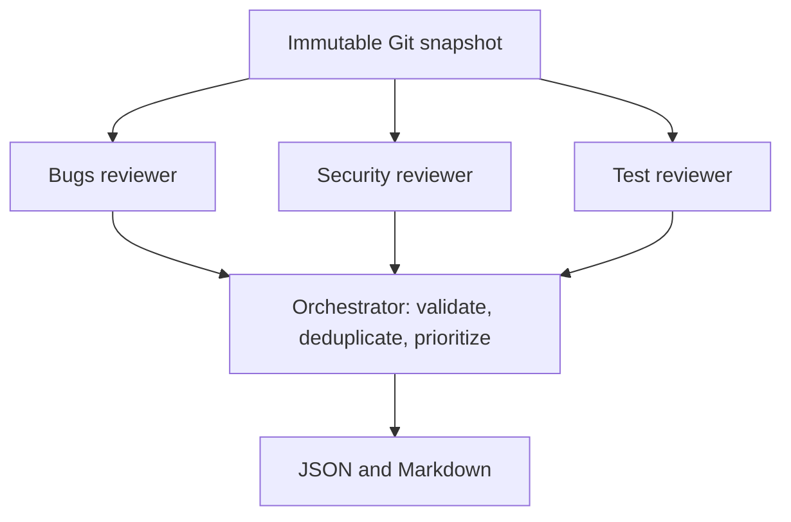

# Code Review Agent

A runnable Python/LangGraph workflow: three specialists review in parallel, then a deterministic orchestrator validates and prioritizes their findings. No eval dataset or benchmark is included. The CLI runs locally; an optional FastAPI webhook and worker publish GitHub PR summary comments. See [DEPLOYMENT.md](DEPLOYMENT.md) for Docker and GitHub App setup.

## Design and deployment

- [Technical design document](docs/code-review-agent-design.docx): architecture, container layout, data flow, review contracts, security, recovery, and limitations.
- [Deployment guide](DEPLOYMENT.md): Docker Desktop, GitHub App credentials, HTTPS webhook setup, and operating instructions.

Two containers share a persistent SQLite volume. The API validates webhooks and queues work; a single worker fetches code, runs the three reviewers, and publishes a summary. ngrok runs on the host for local webhook testing. No code changes, inline suggestions, or automatic merges are published.

For a fresh checkout, copy `.env.example` to `.env` and replace its placeholders. Do not commit `.env` or private keys.

## 1. Run without credentials

Requires Python 3.11+ and Git. From this directory:

```sh
uv venv --python 3.12
uv pip install --python .venv/bin/python -e '.[dev]'
.venv/bin/review-agent --demo --out reports/demo
```

Open `reports/demo/report.md` and `reports/demo/report.json`. Demo mode uses **scripted findings for a synthetic sample**; it exercises graph execution, validation, sorting, and rendering. It does not analyze code or measure reviewer quality.

## 2. Understand the graph



`State.results` uses an append reducer so parallel nodes do not overwrite one another. A list-valued join edge waits for all three outcomes. Each specialist has a deadline; failures become explicit failed outcomes so the other reviews can still produce a partial report.

The first version uses one structured model call per specialist. These are fixed reviewer nodes, not autonomous tool-using agents yet. The orchestrator checks that cited head-file locations exist and evidence excerpts match. It removes exact duplicates within a specialist, then sorts by severity and confidence. It does **not** prove claims, verify whether an issue was introduced, reconcile semantic duplicates, or independently validate severity. The prompts request those judgments from specialists; humans still need to inspect them.

## 3. Review committed changes with Nebius Kimi K2.7 Code

The default model for all three specialists is `moonshotai/Kimi-K2.7-Code`, served by Nebius Token Factory. The Nebius-compatible adapter and `.env` loader are included in the base install.

Copy `.env.example` to `.env` if needed, then put your Nebius key in that file. The CLI automatically loads this editable project's `.env`, even when launched from another directory. Existing shell environment variables take precedence. Use `--env-file /absolute/path/to/.env` to select a different file or for a non-editable installation.

```sh
.venv/bin/review-agent \
  --repo /absolute/path/to/repository \
  --base BASE_COMMIT \
  --head HEAD_COMMIT \
  --out reports/first-review
```

Configuration defaults:

```dotenv
REVIEW_MODEL=nebius:moonshotai/Kimi-K2.7-Code
NEBIUS_BASE_URL=https://api.tokenfactory.nebius.com/v1
```

The adapter uses Chat Completions and function-calling structured output, with 8,192 output tokens and no automatic request retries. The CLI deadline is 180 seconds per specialist. The output budget includes reasoning where the provider counts it; long reviews can still exhaust it. Hosted-model access and response compatibility need a live call to confirm. No inference request is made during configuration or the offline demo.

This is a single-turn adapter. Nonstandard reasoning history is not preserved; a future multi-turn Kimi tool loop will need provider-specific reasoning-history handling.

Override the model with `--model nebius:ANOTHER_MODEL_ID`, or use another LangChain `provider:model` identifier with its integration package and credentials. The optional Anthropic adapter remains available through `pip install -e '.[anthropic]'`. Review content is sent to the configured provider. Do not commit credentials.

The snapshot reads **committed Git blobs**, ignoring uncommitted working-tree edits. Use `--base main --head your-branch` for branch-to-branch differences, or explicitly pass their merge-base as `--base` for changes since divergence. Refs are resolved to immutable commit IDs before collecting context.

The implementation loads Python (`.py`), JavaScript (`.js`, `.jsx`, `.mjs`, `.cjs`), and Java (`.java`), plus configuration text files including XML, Gradle, and properties files. Supporting tests use Python test filenames; JavaScript `.test`/`.spec` names; Java `Test*`, `*Test`, `*Tests`, `*TestCase`, and `*IT` names; or test directories (`test`, `tests`, `__tests__`, `e2e`, and Java `integrationTest`). Discovery is convention-based, not a parser. Unchanged package.json, Maven/Gradle manifests, and pyproject.toml are loaded within the shared context budget. Changed test/config files are not duplicated as supporting context. No Node/JVM execution, compilation, or measured coverage is provided. TypeScript, HTML, CSS, class files, and JARs remain unsupported. It does not load unchanged application dependencies. Deleted files, unsupported types, symlinks, binary content, oversized files, and context-budget exclusions are reported as skipped. A review that skips input or reports agent limitations is marked partial. Renames are treated as deletion plus addition. Changed head files are limited to 24 KB each and source/diff context to 100,000 characters total; provider token limits may still be smaller.

No repository programs, tests, dependency installers, or Git hooks are executed by the reviewer. Git is used only to read commits, trees, diffs, and blobs. Repository text is passed as untrusted data, with no model tools enabled. This is a learning prototype, not a production security gate.

Exit codes: `0` = completed live review or demo; `1` = startup/output error; `2` = partial live review, unsupported/empty review scope, or invalid CLI arguments. Finding severity does not control the exit code.

## 4. Follow the code

Read in this order:

1. `models.py`: shared finding, snapshot, and report contracts.
2. `snapshot.py` and `languages.py`: commit resolution, file/test discovery, and bounded context collection.
3. `reviewers.py`: specialist instructions and live/demo adapters.
4. `workflow.py`: parallel nodes, join, failure handling, and orchestration.
5. `reporting.py` and `cli.py`: rendering and command-line interface.

The external seam is `review_repository(snapshot, reviewer) -> Report`. Dependencies are supplied by the caller; reporting and filesystem writes happen outside it. Demo and model reviewers are two concrete adapters at the same seam.

## 5. Check the implementation

```sh
.venv/bin/python -m pytest
```

These are mechanical implementation checks, not agent-quality evals. They exercise Git snapshot integrity, parallel execution, invalid evidence rejection, and partial failures. No API requests are made.

## Next learning step

Run a live review of a small Python, JavaScript, or Java diff and read each specialist's raw output in `report.json`. Then add a bounded read-only file-search tool so reviewers can inspect unchanged callers and defenses. After that, introduce an evidence-focused model adjudicator and semantic deduplication. GitHub ingestion and durable jobs are available through the optional hosted service; quality evals and semantic adjudication remain later steps.

Framework references: [LangGraph workflow patterns](https://docs.langchain.com/oss/python/langgraph/workflows-agents), [LangChain model initialization](https://docs.langchain.com/oss/python/langchain/models), and [Nebius's Kimi K2.7 Code guide](https://github.com/nebius/token-factory-cookbook/blob/main/models/kimi-k2.7-code.md).
